# Sidereal user guide

Sidereal is **the sky as the space telescopes photograph it, for [Resolume](https://resolume.com)
Arena and Avenue**, as two FFGL plugins in one download: **SW Sidereal**, a source (a piece of sky
on black), and **SW Sidereal Over**, an effect that puts the sky over your clip or turns your clip
into gas for the stars to light. Fifteen famous pictures are on the Target list, from the Pillars of
Creation and the Horsehead to the Whirlpool and Webb's First Deep Field, along with seven generative
skies, and every one of them can be looked at through any of seven telescopes. (The name means "of the stars". It's eight letters long so that
`SW Sidereal Over` fits FFGL's sixteen-character name field with nothing to spare, which is how a
surprising number of product names get decided.)

Nothing in it is a photograph or painted to look like one. Each picture is built the way NASA builds
theirs: gas, lit by the stars inside it, seen through a telescope's real filters, each filter's grey
image given the hue its release gave it. So the rims on the Pillars face the star that lights them,
the teal sits nearest the star, and the same pillars go translucent through Webb, all because that's
what the light does. Supernovae and meteors are on buttons.


*SW Sidereal one second in, rendered by `sdtest`, the offline harness, rather than captured from
Resolume. Top left, the Pillars as released, through Hubble's narrow bands (the defaults). Top right,
the same pillars through Webb NIRCam (Telescope Webb NIRCam). Bottom left, the Whirlpool (Target
Whirlpool). Bottom right, Webb's First Deep Field (Target First Deep). Each panel is a whole
1280 × 720 frame at reduced size.*

> **Before you rely on this:** it's at **v0.1.0**, the first release, and early days. Everything
> below was rendered and measured offline by a harness (`sdtest`) that drives the plugins' own class
> in a headless GL context on a synthetic clock, and `tools/verify.sh` passes on macOS 26 on an Apple
> M4 Max, with its picture checks at 1280×720 and 320×180 on the GPU and five of them again on Apple's
> software renderer. Along a ray from a star, the gas's recombination light adds up to 0.996 and 1.001
> of the ionising photons the star sent that way. The ionisation zones stand in the physics' order,
> [O III] nearest the star, then hydrogen, [S II] and the aromatics. A star's core through F658N is
> 1.312 times its core through F502N, against the filters' 1.314; Hubble's spikes come out four at
> 45°, Webb's six and two, each falling as r^−2.00. A star behind dust dims in red, green and blue as
> Cardelli, Clayton & Mathis's law predicts, to three figures. A lens's Einstein ring lands within a
> pixel of its radius, and a light echo's ring at 0.3424 frame heights against the geometry's 0.3428.
> Thirteen models broken on purpose and eighteen one-character changes to the shipped code are all
> caught, every target shows something at its defaults, and all 30 of the source's controls and 32
> of the Over's changed the picture in the harness's sweep. The only host it's been run in on a Mac is the fleet's own test host, `oxbow`,
> which loads the two as `SW Sidereal` (`SD01`, a source) and `SW Sidereal Over` (`SD02`, an effect)
> and renders through both, so it has **never been loaded into Resolume on macOS**.
>
> **On Windows** it has been in Resolume. The fleet's Arena gate ran CI's build of the release code
> in Resolume Arena 7.27.1 on win-lab, on software rendering with no GPU: both plugins load,
> register (`SD01` a source, `SD02` an effect) and render, every control matches its name, order,
> type, range and default, and Arena's log stayed clean, 15 checks passed and none failed. Against
> still pictures, 24 of the source's 25 testable controls and 27 of the Over's 28 moved the picture;
> Meteors came and went too sparsely to call, and the controls that act only on meteors or a
> supernova can't show in a still. Software rendering says nothing about a GPU or about speed.
>
> How the pictures compare with the real releases is a judgement, not a measurement. The Pillars
> through Hubble, the Horsehead and the Whirlpool land well; the Pillars through Webb come out grey
> where the release is amber, the Cosmic Cliffs' ridge is a harder line than Webb's, and the planetary
> nebulae through Webb's own keys come out blue and lilac where the releases are orange and red.
> Rendering every picture in this guide turned up nine faults, from a black Pleiades to a Fire
> Meteor that sometimes did nothing; they were fixed before release. What's left is under *Known
> limits*, and many controls act only on some targets (*What works where*). The Over has only been seen with the
> harness's test card and a white word on black. Try it on a spare layer before you put it in a show.
>
> This codebase was created with AI assistance, directed and reviewed by a human author.

---

## Installing

Every download has both plugins in it: **SW Sidereal** (a source) and **SW Sidereal Over** (an
effect), as `Sidereal.bundle` and `Sidereal Over.bundle` on macOS and `Sidereal.dll` and
`Sidereal Over.dll` on Windows. Get them from the
[`v0.1.0` release on GitHub](https://github.com/stoatworks-labs/sidereal/releases/tag/v0.1.0)
or the [project page](https://stoatworks-labs.com/software/sidereal/), drop both into
Resolume's effects folder and restart Resolume:

```
macOS    ~/Documents/Resolume Arena/Extra Effects/
Windows  %USERPROFILE%\Documents\Resolume Arena\Extra Effects\
```

Avenue uses the same layout under its own folder name. SW Sidereal shows up among the sources and
SW Sidereal Over in the effects browser.

The macOS download is a universal build (Apple silicon and Intel), as a `.dmg` or a `.zip`. It's
**Developer ID-signed and notarised** by the release pipeline after publication, so the bundles
just load. If macOS refuses a download, it's from before the signing, so download it again. The
Windows download is an x64 installer (`-setup.exe`) or a `.zip`. It isn't code-signed, so the
installer trips SmartScreen once: **More info** → **Run anyway**.

---

## Start here

1. Put **SW Sidereal** in a clip slot and trigger it. That's the Pillars of Creation as Hubble's
   2014 picture shows them: three dark pillars rising into a teal glow, their tips and their
   star-facing edges rimmed in gold and green, their shadows running down the haze behind them, and
   pink stars with four spikes. The camera wanders slowly and the gas turns over as you watch.
2. Change **Telescope** to *Webb NIRCam*. It's the same gas, now in a blue haze, and the pillars have
   gone translucent grey with young stars showing inside them. Try *Webb MIRI*, where the dust glows
   on its own, and *Backyard*, which is what a small telescope and a colour camera would make of it.
3. Put Telescope back to *As Released* and move **Light Angle**. The star that lights the pillars
   swings round the picture and the rims and shadows swing with it.
4. Change **Target**. *Whirlpool*, *Horsehead* and *First Deep* are good next stops. *As Released*
   follows each target to its own release's telescope.
5. On the Pillars, press **Supernova**. A star flares up at the top right, peaks within a second and
   fades, leaving a remnant that grows for minutes. Changing Seed or Target clears it.
6. Change Target to *Gen Starfield* and set **Meteors** to 0.75 for a shower: about thirty a minute,
   all streaking away from a point above the top left corner.
7. For your own footage, put **SW Sidereal Over** on a clip. Clip As *Behind* (the default) puts
   your clip behind the nebula, dimmed by its dust; *Gas* turns your clip's bright parts into gas for
   the stars to light.

---

## Gas, starlight and a filter wheel

The famous space pictures aren't photographs in the holiday sense. Each is a stack of grey images,
one per filter, every filter passing a slice of light: one spectral line of oxygen, of hydrogen or of
sulphur, or a band of the infrared. Whoever makes the picture stretches each grey image to its own
range, gives it a colour (blue for the shortest wavelength, red for the longest, as a rule), adds them
up and stretches the result. The Pillars are gold and teal because the 2014 release put [S II] in
red, hydrogen in green and [O III] in blue. Nothing out there is gold or teal.

Sidereal builds each picture the same way, from three parts.

- **The gas**: columns, clouds, curtains, shells and filaments, each with a column density along the
  line of sight and a thickness. Dense clouds carry dust, a thin ionised haze fills the space between,
  and supernova remnants glow from their own shocks rather than from a star.
- **The stars that light it**, wherever the target puts them, usually off the frame. Their light is
  marched across the picture through the gas, and every ionising photon the gas absorbs comes back out
  as a recombination, so the gas glows with the light it caught. Oxygen needs the hardest photons and
  uses them up first, so [O III] sits nearest the star. Hydrogen glows wherever the light gets to,
  [S II] lives in the partly ionised skin just past the front, and the aromatic molecules and the
  warm dust sit further in.
- **The telescope**: a real filter set with the colour key its release used. Dust dims and reddens
  the light through each filter as the measured extinction law says, glows in the mid-infrared at the
  temperature the starlight keeps it at, and the stars get each telescope's diffraction spikes.

Then the stretch. Each filter's grey image is scaled so the target's own light in it comes to one,
and the sum goes through Lupton's asinh stretch (the **Stretch** control), which lifts the faint gas
a lot and the bright cores a little, so a star's core keeps its colour.

None of the look is drawn. It falls out of the light and the filters:

| what you see | why |
| --- | --- |
| **rims on the side of the gas facing the star, shadow behind** | the gas absorbs the starlight at its lit edge and glows with it there; Light Angle swings the star round and the rims follow |
| **teal near the star, gold at the fronts, olive beyond** (Hubble's narrow bands) | [O III] in the blue filter and hydrogen in the green together nearest the star; hydrogen and [S II] (red) at the fronts |
| **a hotter star turns the haze from green towards cyan** | more of its photons can ionise oxygen twice, so there's more [O III] in the blue filter |
| **pillars that go translucent through Webb, with stars inside** | dust dims 2 µm light about a tenth as much as visible light, so the young stars still inside the pillars show |
| **pink stars through Hubble's narrow bands, white ones through the broad bands** | a narrow filter passes a sliver of a star's light and that palette isn't balanced for stars; the broad-band sets are balanced so a Sun-like star is white |
| **the same cloud in different colours on each telescope** | each telescope's filters see different lines and bands, and its key gives them different hues |

---

## The targets

**Target** picks what's in the sky. The first fifteen are drawn from published pictures: each is its
subject's structure placed where its release shows it, with the release's own filter set and colour
key under Telescope *As Released*. The Pillars, the Cosmic Cliffs and the Horsehead are traced by eye
from their releases, and the rest are built from what their releases show. No image is shipped or
sampled; the outlines are a few dozen points each. The last seven targets are generative, built from
**Seed**.

### Nebulae lit by their stars

**Pillars.** M16's Pillars of Creation, traced from Hubble's 2014 picture, with NGC 6611, the
cluster that lights them, off the top of the frame. As released through Hubble's WFC3 narrow bands:
three olive pillars rimmed in gold and green, teal haze brightest towards the top, shadows down the
haze behind them, the little evaporating globule at the bottom right, and pink stars. Try Webb NIRCam
and Webb MIRI (the 2022 releases), then Light Angle and Star Heat.

**Cosmic Cliffs.** The edge of NGC 3324 in Carina, traced from Webb's 2022 NIRCam picture and shown
through that release's own six-filter key. A bright yellow and cyan crest along a dark blue wall of
cloud, a glowing yellow knot at the left and a faint jet below the crest. It's a harder line than
Webb's billowing ridge: Turbulence 1 and Haze 0.75 rough the crest up and fill the sky above it with
blue.

**Horsehead.** Barnard 33, traced from ESO's 2002 VLT picture, as released through Hubble's broad
bands with H-alpha. σ Orionis is above and behind the cloud, so IC 434 is the far cloud's lit skin,
streaked upwards towards the star, and the horse is a black silhouette against it with a thin red rim
round its head. The cloud it rises from shows as two lit lumps in the bottom corners. It's the
best target for a light echo.

**Orion.** The Orion Nebula, M42, after Hubble's 2006 picture, through Hubble's broad bands. The
Trapezium's stars sit in front of the cloud in the middle and blow its core out to yellow-white, the
Dark Bay comes in from the left as a dark wedge, the Orion Bar is the bright edge low and to the
right, and M43 is the lit sliver at the top.

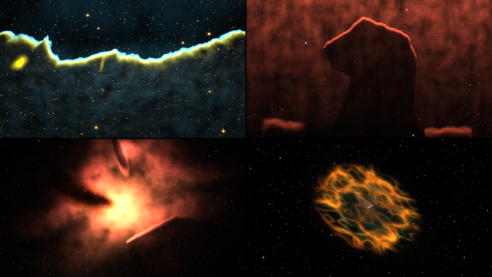

*SW Sidereal one second in, as released, rendered by `sdtest` rather than captured from Resolume. Top
left, the Cosmic Cliffs (through the release's own NIRCam key). Top right, the Horsehead. Bottom
left, Orion. Bottom right, the Crab. Each panel is a whole 1280 × 720 frame at reduced size.*

### Planetary nebulae and supernova remnants

**Crab.** M1, after Hubble's 2005 mosaic, through Hubble's broad bands: an orange cage of
shock-lit filaments round a faint green glow from the pulsar's wind. Nothing lights it but its own
shocks, so most of the Gas and Light groups do nothing here (see *What works where*); Turbulence and
Flow still work the filaments.

**Ring.** M57, a barrel of gas round its white dwarf seen nearly down its axis, as released through
Webb NIRCam with the 2023 key: a violet ring round a dark blue middle, its knots bristling round
the rim. The release is orange and red, so this is one of the misses (see *Known limits*). Through
Telescope *Hubble Narrow* it's the Ring as most people picture it, a cyan middle in an amber rim,
though bright enough that the middle clips.

**Southern Ring.** NGC 3132, its shell and its two central stars, through Webb NIRCam with the 2022
key: a lavender ring, filled faintly, with the white dwarf's companion shining in the middle.

**Helix.** NGC 7293 through Hubble's [O III] and H-alpha filters: a pale blue-grey middle, where
the oxygen glows, inside a red ring of hydrogen, its cometary knots showing as fine radial hairs
round the edge.

**Veil.** A slice of the Cygnus Loop's shock front, through the same two filters. Grey-teal
filaments fill the frame, with faint rust-coloured fringes where the hydrogen sits a little behind
the oxygen. Like the Crab, it's lit by its shocks, not a star.

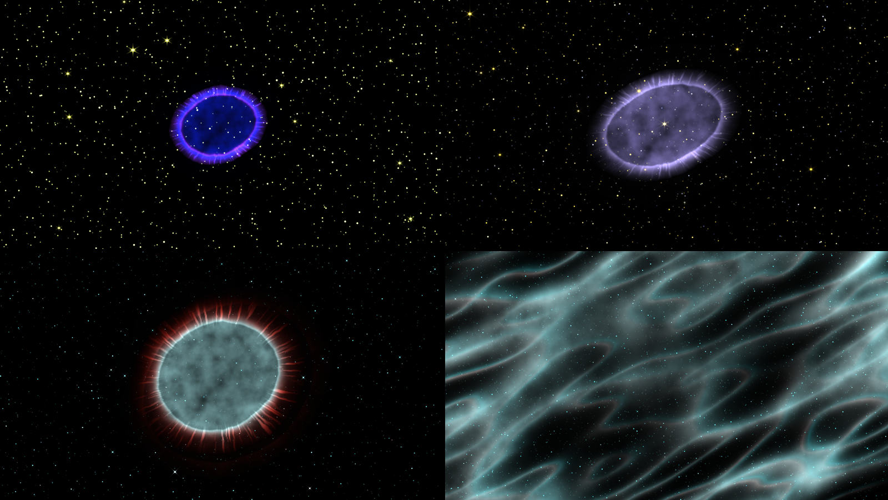

*SW Sidereal one second in, rendered by `sdtest` rather than captured from Resolume. Top left, the
Ring as released. Top right, the Southern Ring as released. Bottom left, the
Helix as released. Bottom right, the Veil as released. Each panel is a whole 1280 × 720 frame at
reduced size.*

### Starlight: the Pleiades and the galaxies

**Pleiades.** M45 through a backyard camera: nine bright B stars at their catalogue magnitudes, in a
dust cloud they light but can't ionise, so it shines only by the starlight it scatters: a blue
reflection nebula round the sisters. It carries three stops of exposure of its own, as the long
exposures it's photographed with do.

**Andromeda.** M31 at 77°, with M32 and M110, through a backyard camera. Its arms are wound so
tightly that its dust lanes read as a dozen neat concentric ellipses.

**Whirlpool.** M51 and NGC 5195, through Hubble's broad bands: blue arms strung with pink H II
regions, a yellow core with dust lanes spiralling into it, and the yellow companion at the end of an
arm. **Flow** turns the arms, slowly, so the arm drifts off NGC 5195 over a minute or so; Flow 0
keeps it there.

**Sombrero.** M104 nearly edge on (84°), its bright bulge behind a black ring of dust, through
Hubble's broad bands.

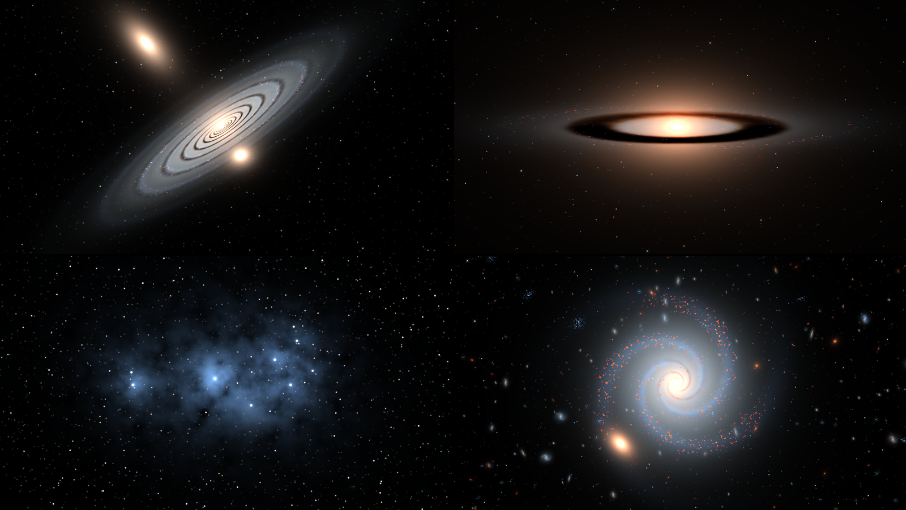

*SW Sidereal one second in, rendered by `sdtest` rather than captured from Resolume. Top left,
Andromeda. Top right, the Sombrero. Bottom left, the Pleiades. Bottom right, Gen Spiral at Seed 0.2. Each panel is a whole 1280 × 720 frame at reduced size.*

### Deep fields

**Ultra Deep.** Thousands of galaxies at every redshift through Hubble's ACS B, V, i and z filters:
ellipticals orange, spirals white and blue, some small, blue and clumpy. Past redshift
1.6 the galaxies stop getting smaller with distance, as the real ones do, and fade fast.

**First Deep.** Webb's First Deep Field, SMACS 0723, through its release's NIRCam set: a cluster at
z = 0.39 whose gravity bends the galaxies behind it into arcs round its Einstein radius, and a bright
foreground star showing Webb's eight spikes. The cluster's brightest galaxy is a soft white oval.
Zoom 0.75 brings the arcs up.

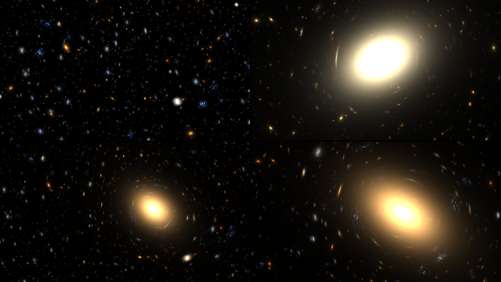

*SW Sidereal one second in, rendered by `sdtest` rather than captured from Resolume. Top left, Ultra
Deep. Top right, First Deep at Zoom 0.75 with Drift 0. Bottom left, Gen Cluster (Seed 0). Bottom
right, Gen Cluster at Seed 0.1, Zoom 0.75, Drift 0. Each panel is a whole 1280 × 720 frame at reduced
size.*

### Generative skies

These seven are built from **Seed**, a different one for each of its 1,001 values, and Seed also picks
the telescope *As Released* gives them.

- **Gen Nebula**: dark clouds and pillars round a hot star placed at random, through Hubble's narrow
  bands or Webb NIRCam, half and half.
- **Gen Dark**: dust silhouettes against the Milky Way's band, through a backyard camera.
- **Gen Planetary**: a shell round a white dwarf, sometimes bipolar, through Hubble's broad bands or
  Webb NIRCam.
- **Gen Remnant**: a ball of shock filaments, sometimes round a pulsar wind, through Hubble's narrow
  or broad bands.
- **Gen Spiral**: a spiral galaxy with a few companions and a sparse deep field behind, through
  Hubble's broad bands or Webb NIRCam.
- **Gen Cluster**: a lensing cluster, like First Deep, through Webb's or Hubble's deep-field set.
- **Gen Starfield**: the Milky Way's band and its dark rifts on about two seeds in three, a plain
  field of stars on the rest, through a backyard camera. Turn **Fly** up to go through it.

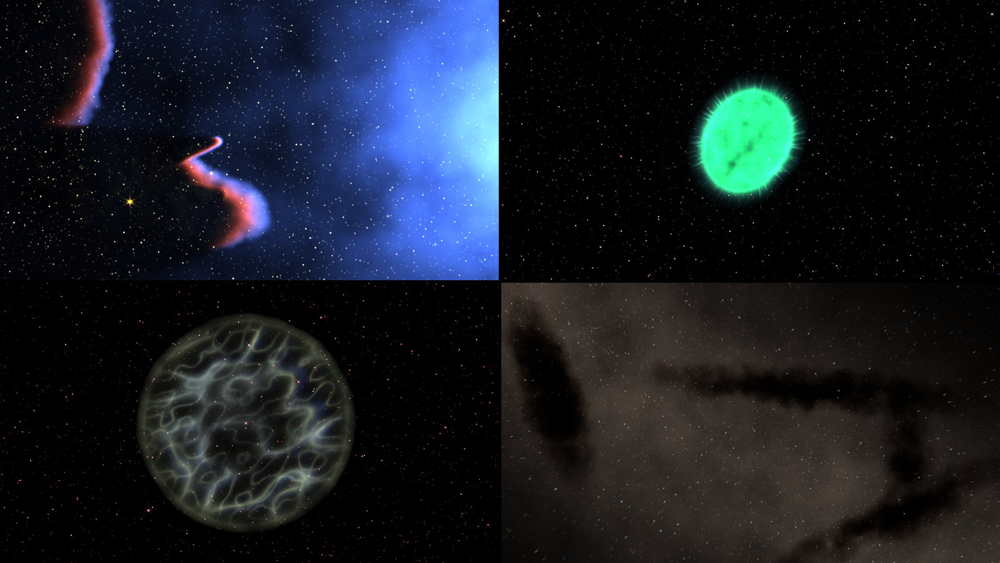

*SW Sidereal one second in, rendered by `sdtest` rather than captured from Resolume. Top left, Gen
Nebula at Seed 0.3 (Webb NIRCam). Top right, Gen Planetary at Seed 0.2. Bottom left, Gen Remnant at
Seed 0.2. Bottom right, Gen Dark at Seed 0.1. Each panel is a whole 1280 × 720 frame at reduced
size.*

---

## The telescopes

**Telescope** picks the filters and the colour key. *As Released* gives each target its own
release's set, some of which you can't get any other way (the Cosmic Cliffs', Southern Ring's and
Ring's NIRCam keys, Hubble's deep-field set, and the Helix's two filters). The other seven work on
anything. Changing telescope is a cut: the gas stays put and only the colours change.

**Hubble Narrow.** Hubble WFC3's F502N ([O III]) in blue, F657N (H-alpha and [N II]) in green and
F673N ([S II]) in red: the Pillars' 2014 palette. Teal near the stars, gold at the fronts. The key
isn't balanced for starlight, so the stars come out pink, as they do in the real thing. Four spikes
at 45°.

**Hubble Colour.** Hubble ACS's broad blue, green and near-infrared filters (F435W, F555W, F814W) plus
F658N for H-alpha, which goes in red with the near-infrared. Balanced so a Sun-like star is white.
Nebulae come out red and orange, galaxies look like galaxies.

**Hubble Infrared.** WFC3/IR's F110W in blue and F160W in yellow, as in the 2013 Horsehead and the
2014 infrared Pillars. Broad infrared bands catch little of a nebula's line light, so it carries a
stop and a half of exposure of its own to keep it near the others; the gas still comes out a deep,
flat blue, and the stars do most of the work.

**Webb NIRCam.** Six filters from 0.9 to 4.7 µm, purple through to red, mostly balanced for
starlight. Dust hardly dims light this red, so pillars go translucent and the young stars embedded in
them show, and the photodissociation skins glow in the aromatic band at 3.3 µm. Six spikes and two
fainter ones. On the Pillars it's grey where Webb's release is amber.

**Webb MIRI.** F770W, F1130W and F1500W, blue, green and red: the mid-infrared, where dust shines by
its own warmth. On the Pillars, the pillars glow cyan against a magenta sky. The stars are big blue
blobs, because a 6.5 m mirror's core is wide at 15 µm.

**Webb Deep.** Six NIRCam broad bands with the deep-field key (F090W and F150W blue, F200W and F277W
green, F356W orange, F444W red), balanced. Galaxies at high redshift come out red; nebulae go orange
and brown.

**Backyard.** A one-shot colour camera on a small refractor, modified so H-alpha gets through, as
astrophotographers' cameras are. Natural colour, so nebulae come out pink and red.
No spikes (a refractor has no spider) and 2.6 pixels of the atmosphere's blur at 1080 lines.

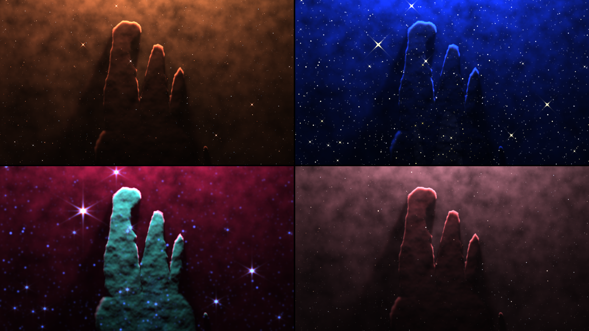

*The Pillars, SW Sidereal otherwise at its defaults one second in, rendered by `sdtest` rather than
captured from Resolume. Top left, Telescope Hubble Colour. Top right, Hubble Infrared. Bottom left, Webb MIRI. Bottom right, Backyard. Each panel is a whole 1280 × 720 frame at reduced size. Hubble
Narrow and Webb NIRCam are in the picture at the top.*

---

## The controls

Resolume shows every slider as 0 to 1. The ranges below are what the slider positions mean. **Most
controls are relative to the target**: at 0.5 a target looks as it was drawn, and the control bends
it either way. Gas Density 0.5 is the Pillars' own gas on the Pillars and the Horsehead's on the
Horsehead. The source has 30 controls and the Over 32, in these groups, in this order, with the About
group last.

### The Scene group

**Target** (fifteen pictures, then seven generative skies; default *Pillars*). See *The targets*.

**Telescope** (*As Released*, *Hubble Narrow*, *Hubble Colour*, *Hubble Infrared*, *Webb NIRCam*,
*Webb MIRI*, *Webb Deep*, *Backyard*; default *As Released*). See *The telescopes*.

**Seed** (0 to 1 in steps of 0.001, so 1,001 skies; default 0). On a generative target it's
everything: the clouds, the shells, the galaxies, where the star is and which telescope *As Released*
means. On a picture target it only moves the random field stars. Changing Seed or Target clears any
meteors and supernova in progress; changing Telescope doesn't.

### The Gas group

**Gas Density** (a quarter to four times the target's column of gas, geometrically; default 1×, at
the middle). Thinner gas lets more light in, so the pillars go translucent and their rims soften; at
1 they're dense, dark and mottled, with harder rims. In the Over with Clip As *Gas*, it scales your
clip's gas too.

**Turbulence** (0 to three times the target's own, a straight line in two halves: 0 at the bottom, 1×
at the middle, 3× at the top; default 1×). How far the noise moves the gas's edges and varies its
density. At 0 the pillars are smooth-edged shapes in a smooth haze, with clean shadow cones; at 1 the
haze is mottled and the tips go ragged.

**Flow** (0 to 0.12 frame heights a second; default 0.03, at 0.25). How fast the turbulence evolves.
At 0 the gas is frozen, and with Drift at 0 as well the picture doesn't change at all from one frame
to the next. Flow also turns the galaxies' arms: a minute in at the default, the Whirlpool's arm has
drifted well off NGC 5195.

**Haze** (0 to three times the target's own ionised interior, in two halves; default 1×). The thin,
glowing gas between the clouds. At 0 the Pillars stand lit against black; at 1 the haze fills the
frame. It multiplies the target's own haze, so where there's none it does nothing.

**Dust** (a tenth to ten times the dust per unit of gas, geometrically; default 1×). How much the gas
dims and reddens what's behind it: mostly the haze and stars behind the clouds, since the lit faces
are in front of their own dust (see *Known limits*).

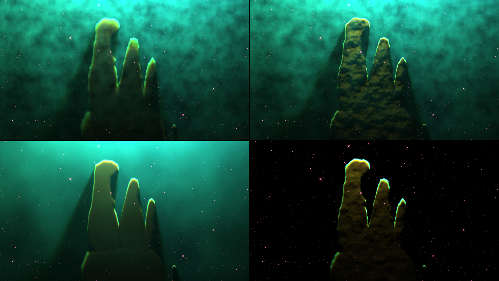

*The Pillars, SW Sidereal otherwise at its defaults one second in, rendered by `sdtest` rather than
captured from Resolume. Top left, Gas Density 0 (a quarter of the gas). Top right, Gas Density 1
(four times). Bottom left, Turbulence 0. Bottom right, Haze 0. Each panel is a whole 1280 × 720 frame
at reduced size.*

### The Light group

These act on the stars that light the gas, so they do nothing where nothing is lit by a star: the
remnants, the galaxies, the deep fields and the starfields.

**Starlight** (a tenth to ten times the stars' ionising output, geometrically; default 1×). More
photons light more of the gas and brighten everything they reach. At 1 the Pillars wash out to
bright cyan; at 0 they're a dim green glow round dark shapes.

**Star Heat** (0.6 to 1.6 times the stars' temperature, geometrically; default 1×). A hotter star
makes more photons that can ionise oxygen twice, so through Hubble's narrow bands the haze moves from
green (Star Heat 0.25, about 33,000 K for the Pillars' main star) through the default teal to cyan
and blue (0.75, about 53,000 K). It's a brightness control as well: at 0 the Pillars are a dim
green, at 1 a bright cyan.

**Light Angle** (−180° to +180°, anticlockwise; default 0°, at the middle). Swings the stars round the
middle of the target. On the Pillars, 0.25 puts the star off the right of the frame and 0.75 off the
left, and the rims, the bright haze and the shadows all follow; 0 lights them from below. A target
whose star sits in its middle (the planetaries) doesn't change.

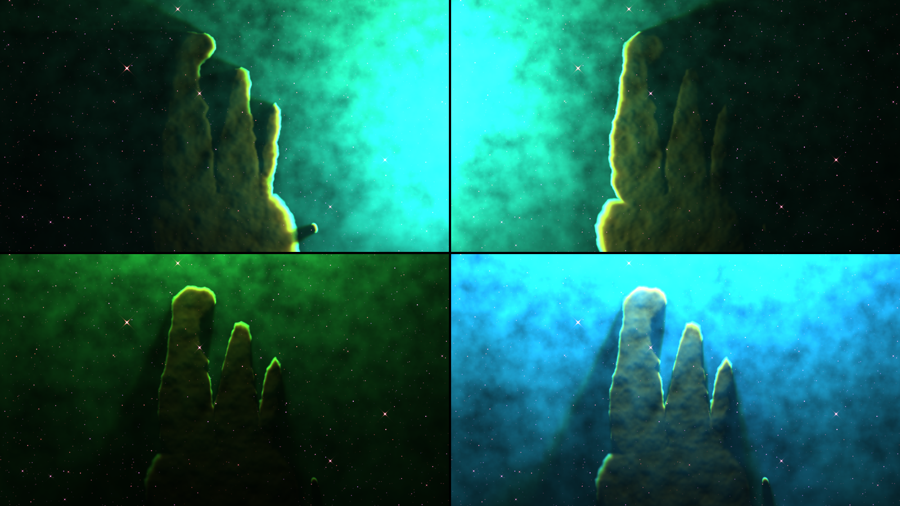

*The Pillars, SW Sidereal otherwise at its defaults one second in, rendered by `sdtest` rather than
captured from Resolume. Top left, Light Angle 0.25 (the star off the right). Top right, Light Angle
0.75 (off the left). Bottom left, Star Heat 0.25. Bottom right, Star Heat 0.75. Each panel is a whole
1280 × 720 frame at reduced size.*

### The Stars group

**Stars** (0 to three times the target's faint stars, in two halves; default 1×). The density of the
faint field. The bright stars, the ones with spikes, are all or nothing: they're there at any value
above 0. At 0 there are no stars at all, though a supernova still shows.

**Spikes** (0 to three times the telescope's own diffraction spikes, in two halves; default 1×).
Hubble's four, Webb's six and two. The spikes belong to the telescope, so Spin turns the sky under
them and they stay where they are. Backyard has none, whatever this says.

**Seeing** (0 to 8 pixels of blur at 1080 lines, scaled with the composition; default 0). Blurs the
stars, as the air does to a ground-based telescope. The gas is untouched (with Stars at 0, Seeing
changes nothing).

### The Camera group

**Zoom** (a quarter to four times, geometrically; default 1×). In and out on the target. Zoomed out,
the Pillars sit small under the bright cloud round their star, with a crowd of faint stars round
them: the target's gas is only built round its own frame.

**Pan X** and **Pan Y** (−1 to +1 frame heights; default 0, at the middle). Moves the camera. The gas
and the stars that light it move together, so the shadows stay true.

**Spin** (−180° to +180°; default 0°). Turns the picture. It's an angle, not a speed: for a slow
turn, automate it. The spikes don't turn.

**Drift** (0 to 0.05 frame heights a second; default 0.0125, at 0.25). A slow wander of the camera,
never more than about 0.07 frame heights from where Pan puts it; at the default it sways from side to
side about every thirty seconds. At 0 the camera stays where Pan puts it.

**Depth** (0 to 2; default 1, at the middle). Parallax: when the camera moves, the bright stars at
different depths move against the gas, the near ones more. It does nothing while the camera is still,
so with Pan in the middle and Drift at 0 it changes nothing.

**Fly** (0 to 1.5 star depths a second; default 0). Forward through the stars: the faint field
becomes four layers coming towards you, streaking out from the middle. The gas and the bright stars
stay put. It replaces the faint field, the young stars inside the pillars included, and draws the
flying stars over the gas.

### The Events group

**Meteors** (0 for none, then 0.5 to 120 a minute, geometrically; default 0), **Meteor Kind**
(*Sporadic*, *Shower*; default *Shower*), **Fire Meteor** (a button), **Supernova** (a button),
**SN Speed** (2 to 200 days of the light curve a second, geometrically; default 20) and **Light
Echo** (0 to 1; default 0.5). See *Meteors, supernovae and light echoes*, below.

### The Output group

**Exposure** (−4 to +4 stops; default 0, at the middle). Each stop doubles the light, on top of the
target's own exposure. At 0 the Pillars are near black, at 1 a white-out with teal in it.

**Stretch** (0 is linear, then asinh's softening from 0.3 to 40, geometrically, times the target's
own; default about 3.5, at the middle). How hard the faint light is lifted. At 0 it's linear, dark
with bright cores; at 1 the faint gas comes up to meet the bright and it all goes flat and pale. The
galaxies and deep fields carry four to six times the nebulae's stretch, as their releases did.

**Saturation** (0 to 2; default 1, at the middle). 0 is grey; 1 is the colours as keyed; 2 doubles
them.

**Clip As** and **Mix** are the Over's, below.

### What works where

Several controls act on something only some targets have. I measured each at 0 and 1 against its
default on every target (320 × 180, a second and a half in):

| control | nebulae (Pillars, Cosmic Cliffs, Horsehead, Orion, Gen Nebula) | planetaries (Ring, Southern Ring, Helix, Gen Planetary) | remnants (Crab, Veil, Gen Remnant) | Pleiades | galaxies and deep fields | Gen Starfield, Gen Dark |
| --- | --- | --- | --- | --- | --- | --- |
| Gas Density | yes | yes; a little on the Ring | nothing | a little | nothing | a little |
| Turbulence | yes | a little | yes | barely | nothing | a little |
| Flow | yes | barely | yes | barely | turns the spirals' arms | barely |
| Haze | yes | barely | nothing | nothing | nothing | barely |
| Dust | yes | yes; a little on the Ring | nothing | a little | nothing | yes, on the dark clouds |
| Starlight | yes | yes | nothing | yes | nothing | barely |
| Star Heat | yes | a little | nothing | a little | nothing | nothing |
| Light Angle | yes; a little on Orion | nothing | nothing | a little | nothing | nothing |
| Light Echo | yes, after a supernova | a little | nothing | a little | nothing | barely |

"Yes" is a change you'd see across the room; "a little" moved the average pixel by under three levels
in 255, "barely" by under half a level, and "nothing" is no change at all, or as near as makes no
difference. Everything else (the Stars and Camera groups, the meteors and the supernova itself, and
Output) works everywhere, except Spikes through the Backyard telescope.

---

## SW Sidereal Over: two ways to use your clip

The Over runs the same sky with your clip in it. **Clip As** decides how.

**Behind** (the default). Your clip is whatever lies behind the nebula. The gas's dust dims and
reddens it, through the telescope's own filters, and the nebula's light is added on top. On the
Pillars your picture shows through the haze and disappears behind the pillars. Exposure is the
nebula's, not your clip's: at Exposure 0 (four stops down) the nebula all but vanishes and the
pillars are black shapes over your clip at full brightness. Through Webb's telescopes the dust dims
your clip less, as it does the stars, and it shows through the pillars.

**Gas.** Your clip's brightness becomes gas, added to the target's own, and the target's stars light
it. A white logo on black becomes a wall of gas with a lit rim on the side facing the star and a
shadow cone behind it, the way the pillars are lit. It works best on bright shapes on black;
a full-frame picture becomes a wall of gas with little contrast, and the harness's test card comes out
as a ghost of itself. Your clip stays put on screen while Pan, Zoom and Spin move the sky, so you can
pan the target's own gas out of the way (Pan X 1 takes most of the Pillars off the left), and Light
Angle then puts the star where you want it. Gas Density thickens your clip's gas with the target's.
Avoid the planetaries: a logo across the white dwarf in the middle swallows its light.

**Mix** (0 to 1, default 1). The whole effect against your clip. At 1 the output is opaque whatever
your clip's alpha; at 0 it's your clip, alpha and all (the harness checks that, and a render at Mix 0
came out identical to the clip).

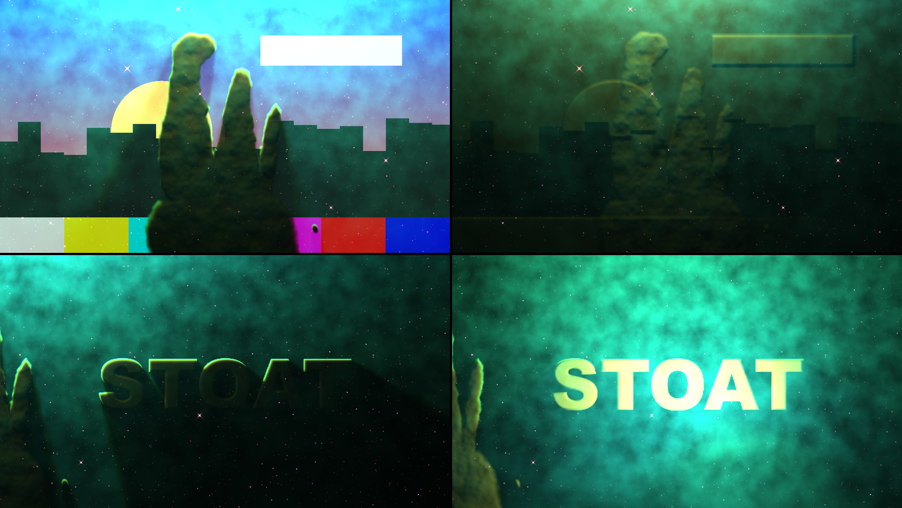

*SW Sidereal Over, rendered by `sdtest` rather than captured from Resolume, one second in. Top left,
the harness's night-city card with the defaults (Clip As Behind). Top right, the same with Clip As
Gas. Bottom left, a white word on black with Clip As Gas, Pan X 1 and Drift 0. Bottom right, the
same with Light Angle 0.25. Each panel is a whole 1280 × 720 frame at reduced size.*

---

## The source is opaque

SW Sidereal's output is opaque everywhere, black where space is empty (every pixel of every render in
this guide has full alpha). To put the sky over another layer, use a blend that ignores black: Add,
Screen or Lighten. The Over doesn't need that: it's your clip and the sky in one.

---

## Meteors, supernovae and light echoes

### Meteors

Each meteor follows the classical ablation curve: it brightens slowly, peaks about 78% of the way
through its flight and goes out abruptly when the body's used up. Fast ones (above about 44 km/s) are
green with magnesium and oxygen, and the bright fast ones leave a green train hanging along their path
after the head's gone; slow ones are orange with sodium and iron. Most are faint and a few are
fireballs. Real space telescopes see none of this, being above the air: for as long as a meteor
lasts, the plugin's telescope is on a mountain. Meteors are drawn on the screen, so Pan, Zoom, Spin
and Depth don't move them.

**Meteors** sets the rate:

| slider | 0 | 0.01 | 0.25 | 0.5 | 0.75 | 1 |
| --- | --- | --- | --- | --- | --- | --- |
| meteors a minute | none | 0.5 | 2 | 7.7 | 30 | 120 |

They arrive at random at that rate, never more than 24 in the sky at once.

**Meteor Kind.** *Shower* (the default) runs at the Perseids' 59 km/s: every trail points back to
one radiant above and to the left of the frame, and each lasts 0.6 to 1.7 seconds, green. *Sporadic*
meteors come from anywhere at 12 to 70 km/s and last half a second to eight and a half.

**Fire Meteor** launches one now, of whichever kind is set, and it's always one you'll see: a
fireball on a shallow path, with its trail well inside the picture at any shape from 4:3 to 21:9,
lasting the best part of a second or more. Its speed, direction and brightness beyond that are
drawn at random. The trail is visible from the press and peaks most of the way through.

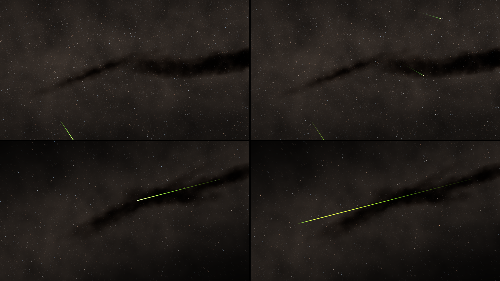

*Gen Starfield, SW Sidereal otherwise at its defaults, rendered by `sdtest` rather than captured from
Resolume. Top, Meteors 1 (a shower at 120 a minute), three seconds in (left) and 3.8 (right): every
trail points back to the radiant off the top left. Bottom, Seed 0.006 with Meteor Kind Sporadic
and Fire Meteor pressed at 1.67 seconds: two thirds of a second later (left) and 1.67 seconds later
(right), the head gone and the train left. Each panel is a whole 1280 × 720 frame at reduced size.*

### Supernovae

**Supernova** sets off a type Ia at the target's own place for one: a star that rises to outshine
everything round it, fades on the decay of nickel and then cobalt, cools from blue-white to
orange, and leaves a remnant, a shell of shocked gas that grows fast and then slower (as t, then as
t^(2/5)) and fades over thousands of days. A second press starts a new one; changing Seed or Target
clears it.

**SN Speed** sets how many days of the supernova pass each second, and so how long everything takes.
The light curve peaks on day 15.3, the remnant is fully lit by day 60 and has dimmed by half around
day 2,100, and the whole thing is cleared at day 12,000:

| SN Speed | days a second | peak | remnant lit | remnant at half | gone |
| --- | --- | --- | --- | --- | --- |
| 0 | 2 | 7.7 s | 30 s | 17 minutes | 100 minutes |
| 0.25 | 6.3 | 2.4 s | 9.5 s | 5.5 minutes | 32 minutes |
| 0.5 (default) | 20 | 0.77 s | 3 s | 1.7 minutes | 10 minutes |
| 0.75 | 63 | 0.24 s | 0.95 s | 33 s | 3.2 minutes |
| 0.8 | 80 | 0.19 s | 0.75 s | 26 s | 2.5 minutes |
| 1 | 200 | 0.08 s | 0.3 s | 10 s | 1 minute |

In the harness, at the default, the Pillars' remnant was still there, large and faint, five minutes
after the press, and gone at ten. It's the same size on every target, which is fiction in a galaxy:
in the Whirlpool it's a red bubble a third the galaxy's width fifteen seconds after the press.

### Light echoes

A supernova's light also scatters towards you off a dust sheet in front of it, later the further out
it lands: a ring racing outwards, brightest in the middle. It only lights whatever gas and dust the
target has there, so it sweeps through the Horsehead's head in a blue arc, lilac across the
Pillars, blue through Orion's clouds, and not at all in the galaxies. **Light Echo** sets its brightness: 0 is none, the
default 0.5 is clear on the Horsehead, 1 is clear on the Pillars.

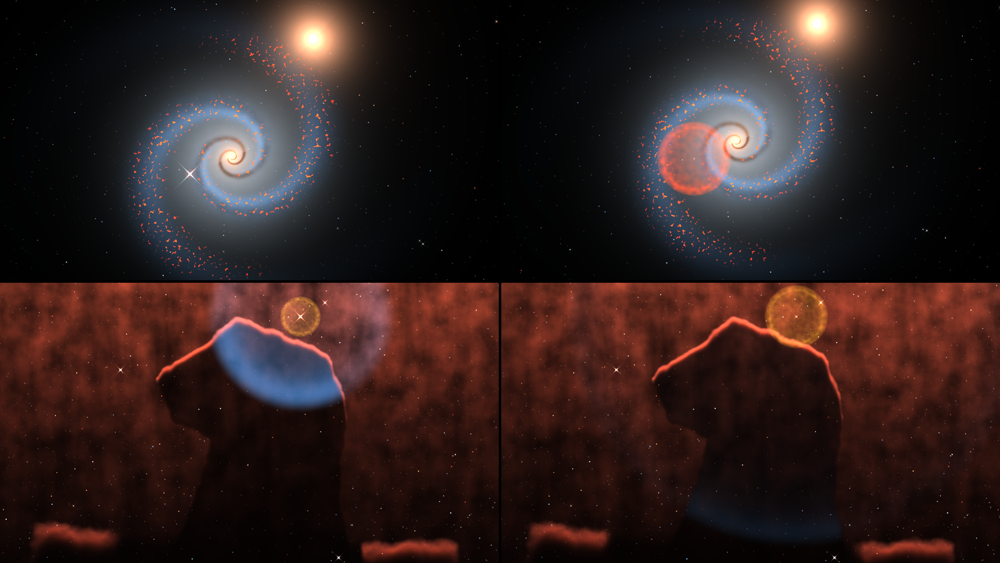

*SW Sidereal with Supernova pressed at 0.17 seconds, rendered by `sdtest` rather than captured from
Resolume. Top, the Whirlpool at the default SN Speed: at the peak, 0.78 seconds after the press
(left), and fifteen seconds after (right). Bottom, the Horsehead at SN Speed 0.8: day 66 (left), the
echo crossing the horse's head inside the golden remnant, and day 199 (right), the echo low on its
neck. Each panel is a whole 1280 × 720 frame at reduced size.*

### Recipes for the events

**A meteor on the hit.** Gen Starfield, Meteor Kind *Shower*, and map **Fire Meteor** to a MIDI note
or a cue. Showers are quick and green; *Sporadic* gives slow orange ones too. Press twice in quick
succession for a big moment.

**A shower that builds.** Automate **Meteors** from 0.25 (two a minute) to 1 (120 a minute) over the
build. The rate follows the slider as it moves.

**A supernova on the drop.** The Horsehead, SN Speed 0.8 and Light Echo 0.75. Map **Supernova** to a
note: the star peaks a fifth of a second after the press, and the echo sweeps down through the horse
over the next two seconds. Press it again on the next drop and it starts over; change Seed to the
next value and back to clear it.

---

## Recipes

**Hubble to Webb on a cue.** One layer of SW Sidereal on the Pillars, with **Telescope** mapped to a
button or a MIDI value: *Hubble Narrow*, then *Webb NIRCam*, then *Webb MIRI*. Each change is a cut,
with the gas and the camera carrying on. For a crossfade, use two layers with the same Target and
Seed, one telescope each, and set Drift and Flow to 0 on both: the camera's wander and the gas count
from when each instance started, so otherwise the two won't line up.

**The star comes up.** The Pillars with **Light Angle** at 0 (lit from below) and Exposure at 0.3,
both automated up to 0.5 over a minute. The lit side of the pillars climbs from their feet to their
tips.

**A logo in the Pillars.** SW Sidereal Over on your logo, white on black. Clip As *Gas*, Pan X 1 to
push the Pillars' own gas off to the left, Drift 0, and Light Angle 0.25 to bring the star round in
front, and the logo lights up like a pillar of gas several light-years tall, which is a lot of
effort for a lower third. Light Angle 0.5 lights it from above, with its shadows falling down the
frame.

**Silhouettes over your picture.** SW Sidereal Over on your clip, Clip As *Behind*, the Pillars, and
**Exposure** at 0: the nebula's light all but goes and the pillars stand as dark shapes over your
clip. Telescope *Webb NIRCam* makes them translucent.

**Flying through a starfield.** Gen Starfield, **Fly** 0.5, Stars 1, Drift 0. Step Seed for another
stretch of the Milky Way.

**A deep-field backdrop.** First Deep at Zoom 0.75 and Drift 0.5: a slow wander round the cluster
and its arcs.

**Galaxies that keep still.** Flow 0 on the Whirlpool, Andromeda or Gen Spiral, or the arms turn.

---

## Time comes from the host

This is what the code does and the harness exercises; none of it has been tried in Resolume. The
camera's wander, the gas's flow and Fly move on by the host's time since the last frame, at most a
tenth of a second at a time, so a stall doesn't make them jump and a step backwards passes no time.
The meteors and the supernova are timed from the host's clock itself, so if it jumps, they jump.
While it works out whether the host counts in seconds or milliseconds (Resolume has been seen sending
both), the plugin runs on its own clock for a few frames. Changing the composition's size draws the
same picture as a fresh instance, and meteors and a supernova in progress carry on.

---

## How it works

When Target or Seed changes, the CPU builds the target (its gas, stars, galaxies and deep field) into
tables; when Telescope changes, it works out what every kind of light looks like through the filters
after any amount of dust, with each filter's gain set so the target's own light in it comes to one.
Then, every frame, on the GPU:

1. **The field**, at half the composition's size plus a margin: the gas's column, thickness and dust
   at every point, with the turbulence.
2. **The light**: from every point, a march towards each of the target's stars (up to twelve),
   adding up what's absorbed on the way, which sets the hydrogen, [O III], [S II], aromatic and dust
   light there.
3. **The stars**: the bright ones, the supernova and the meteors, each drawn per filter with that
   telescope's core, halo and spikes.
4. **The picture**: the light through the palette, the galaxies, the faint stars and the remnant,
   then Exposure, Stretch and Saturation, and in the Over your clip and Mix.

---

## Performance

Measured by the offline harness (`sdtest --bench`) on an Apple M4 Max, GPU time by
`GL_TIME_ELAPSED`, the median of 60 frames after a warm-up:

| plugin | target | 720p | 1080p | 4K |
| --- | --- | --- | --- | --- |
| SW Sidereal | Pillars | 0.97 ms | 1.99 ms | 7.7 ms |
| SW Sidereal | Cosmic Cliffs | 1.08 ms | 2.18 ms | 8.3 ms |
| SW Sidereal | Whirlpool | 1.36 ms | 2.91 ms | 11.4 ms |
| SW Sidereal | First Deep (lensed) | 1.30 ms | 2.66 ms | 10.1 ms |
| SW Sidereal Over | Pillars | 0.97 ms | 1.99 ms | 7.7 ms |

These are the README's figures; my own run for this guide came within a tenth of a millisecond of
every row. That's under a fifth of a 60 fps frame at 1080p. Most of the cost is per pixel, so at 4K
the Whirlpool takes about two thirds of a frame, and a smaller GPU will feel 4K. Nothing was timed
inside Resolume, and nothing was timed on Windows.

---

## If it looks wrong

**It's nearly black.** Check Exposure, Starlight and Star Heat, which are all brightness controls.
Every target shows something at its defaults (the harness checks that), so a black picture is a
control somewhere, or Stars at 0 on a deep field.

**A slider does nothing.** See *What works where*: most of the Gas and Light groups have nothing to
act on in a galaxy, a deep field or a supernova remnant.

**The Whirlpool's arm has wandered off NGC 5195.** Flow turns the arms. Flow 0 keeps them as drawn.

**A big bubble is growing over everything.** A supernova's remnant, which stays for minutes at the
default SN Speed. Changing Seed or Target clears it, so step Seed and back.

**Stars streak across the pillars, and the stars inside them have gone.** That's Fly.

**Your clip has gone dark behind the gas.** That's Clip As *Behind*. Gas Density 0 thins the gas, and
a Webb telescope sees through more of it.

**Your clip barely shows as gas.** Clip As *Gas* turns brightness into gas, so a busy full-frame
picture becomes a wall with little contrast. Use bright shapes on black, check the target's star is
on your clip's side (Light Angle), and keep the clip off a planetary's white dwarf.

**The clip's transparency has gone.** At Mix 1 the Over is opaque. Lower Mix to bring the clip's own
alpha back.

**The sky hides the layer under it.** The source is opaque: use Add, Screen or Lighten.

**Neither plugin is in the browser.** Check the folder under *Installing*, and that Resolume was
restarted.

**It does nothing at all.** That's what a shader that won't compile looks like. The error is in the
log:

```
macOS    ~/Library/Logs/sidereal/sidereal.YYYY-MM-DD.log
Windows  %LOCALAPPDATA%\sidereal\logs\sidereal.YYYY-MM-DD.log
```

It records the GL vendor, renderer and version at load, which shader failed if one did, whether the
buffers couldn't be allocated, each target and telescope as they're built, and what unit the host's
clock arrives in.

---

## Known limits

- **Never loaded into Resolume on macOS**, only into `oxbow`. For Windows, see the box at the top.
- **On a Mac, only ever run on an Apple M4 Max** and Apple's software renderer, although the macOS
  build has an Intel slice.
- **The pictures are like the releases, not copies.** Each telescope's colour comes from its real
  filters and key, but the strengths of the lines, the dust's glow and the stars against each other
  are this model's, tuned by eye against the releases. The Pillars through Webb NIRCam are grey where
  the release is amber; the Cosmic Cliffs' ridge is a harder line than Webb's; the planetaries
  through Webb's own keys are blue and lilac where the releases are orange and red.
- **The Ring through Hubble's narrow bands clips in the middle** at the default exposure, and
  **Hubble Infrared's gas is one flat blue**.
- **Dust has a ceiling.** The extinction tables stop at a visual optical depth of 12, so past that
  more Dust dims dense gas no further, and through the infrared telescopes no amount of it hides the
  stars inside the pillars (across the whole slider, the light inside a pillar through Webb NIRCam
  changed by 5%). It hardly touches the lit faces, which are in front of their own dust.
- **Hard shadows.** The gas is flat, so a dense cloud's shadow has hard edges and runs on to the
  edge of the frame.
- **Some shapes read oddly.** Andromeda's dust lanes are a dozen neat concentric ellipses; the
  Horsehead's base is two separate lit lumps in the bottom corners; a bipolar Gen Planetary's lobes
  are faint.
- **Small compositions crowd with stars.** A star can't be drawn much smaller than a pixel, so below
  about 640 × 360 the faint field gets busy: Gen Starfield's average pixel is 0.198 of white at
  320 × 180, against 0.129 at 1280 × 720 and 0.126 at 1920 × 1080.
- **Flow turns the galaxies' arms**, so a spiral drifts from its release's look over a minute or so.
- **The supernova remnant is the same size on every target**, far too big in a galaxy, and stays for
  minutes at the default SN Speed. **The light echo needs gas or dust**, so a galaxy's has none.
- **Meteors in a space telescope are fiction.** Hubble and Webb are above the air.
- **Fly replaces the faint stars**, the infrared's embedded ones included, and draws its flying stars
  over the gas.
- **The model's approximations**: the gas is flat, with a depth along the line of sight that the
  light knows only as each element's thickness; the path to a star off the picture is lengthened as
  if straight; the haze absorbs a fifth of the light its photon count says; [O III] is scaled to a
  40,000 K star's hard photons rather than computed from oxygen's cooling; and the faces of the gas
  are lit as if the column were a height.
- **No audio input.** Map Fire Meteor and Supernova to Resolume's audio analysis, BPM or cues.
- **The looks were judged by eye** on the harness's renders, and the Over has only been seen with
  the harness's test card and a white word on black.
- **No presets beyond the targets and no OpenFX version.** Resolume saves parameter presets itself.
- **The browser demo is a demo, not the plugin.** It runs the plugins' own shaders and a JavaScript
  port of the rest in WebGL2, with no Resolume, and lists on the page what it doesn't reproduce.

---

## About

The last group, **About**, has the plugins' name, version, licence and maker, and buttons that open
this guide, the project page, the source on GitHub and the support page in your browser.

## Links

- Project page: [stoatworks-labs.com/software/sidereal](https://stoatworks-labs.com/software/sidereal/)
- Source: [github.com/stoatworks-labs/sidereal](https://github.com/stoatworks-labs/sidereal)
- User guide: [stoatworks-labs.com/software/sidereal/guide](https://stoatworks-labs.com/software/sidereal/guide/)
- Browser demo: [sidereal-demo.stoatworks-labs.com](https://sidereal-demo.stoatworks-labs.com/), both plugins
  in your browser, nothing to install

## Reporting something

If something's wrong, shout at
[github.com/stoatworks-labs/sidereal/issues](https://github.com/stoatworks-labs/sidereal/issues).
A screenshot, the Target, the Telescope and the Seed, any other controls you moved, whether you'd
pressed Supernova or Fire Meteor, and the composition's resolution and frame rate are usually enough.
If the plugin did nothing, attach the log.

The extinction follows Cardelli, Clayton & Mathis (1989), the nebular lines Osterbrock & Ferland
(2006), the supernova Arnett (1982) and Nadyozhin (1994), the meteors Öpik (1958), and the stretch
Lupton et al. (2004); the full list of the work it stands on, and the releases the targets were
traced from, is in
[ATTRIBUTIONS.md](https://github.com/stoatworks-labs/sidereal/blob/main/ATTRIBUTIONS.md).
